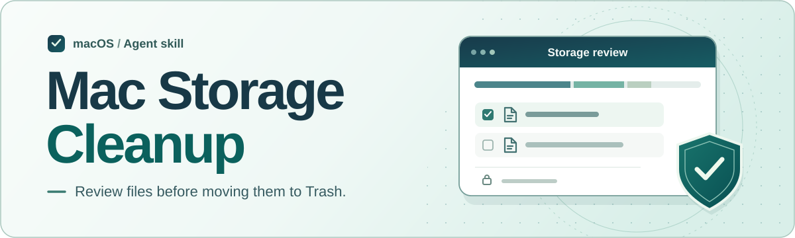

# Mac 储存空间安全清理 Skill

“系统数据占了几十 GB，能删什么？”把 Mac「储存空间」里的分类和容量告诉 AI，它会帮你判断：**哪些值得检查，哪些应交给应用管理，哪些应该保留。**

当前版本是一份给 AI 助手使用的中文技能说明。只提供容量数字就能开始，无需上传文件、授予完全磁盘访问权限或运行清理脚本。在普通会话中，助手负责解释；移动或删除具体文件，由你在 Mac 上核对并确认。

**[阅读技能规则](SKILL.md) · [查看设计与验收案例](docs/design.md)**

## 🧭 第一次使用

1. 用支持载入技能的 AI 助手打开本项目的 [SKILL.md](SKILL.md)。普通聊天工具也可以将该文件作为附件，明确让助手按其中的规则分析。
2. 打开 Mac 的 **苹果菜单 → 系统设置 → 通用 → 储存空间**。记下可用容量和占用最大的两三个分类，无需提供用户名、完整文件路径或私人文件名。
3. 把下面的示例换成自己的数字：

   > 请按这个 Skill 帮我判断下一步该看哪里。我的 Mac 还剩 9 GB，「系统数据」有 64 GB，「文稿」有 38 GB。请先列出要核对的信息，不移动或删除任何文件。

## 🔎 一份清理建议会是什么样子？

假设你补充了三个发现，助手应给出三种不同的建议：

| 你的发现 | 助手的建议 | 理由 |
| :--- | :--- | :--- |
| 下载里有一个 3 GB 的旧安装镜像 | **仅报告**，先核对是否还需要离线重装 | 文件大、日期旧，都不能证明它多余。 |
| 浏览器里有一类「缓存的图片和文件」 | **通过浏览器设置处理**，核对选项后自行确认 | 应用能区分缓存、Cookie、历史记录和密码。若无法单选缓存，就停下。 |
| iCloud 云盘中有两份同名课件 | **保留**，不把它们列为清理候选 | 同名不能证明重复，删除同步项目还可能影响其他设备。 |

## 🛟 删除前，谁来确认？

**普通会话：** 只有你认出某个本地普通文件、明确决定处理它后，助手才说明如何用访达把该文件移到废纸篓。想撤回时，在废纸篓选中它并点「放回原处」。**移入废纸篓仍占空间**；如需永久删除某一项，要重新核对该项并在访达确认。

**接入专用执行器的宿主：** 本仓库没有附带执行器。若要扩展，宿主必须先证明文件是已完成任务留下、可丢弃的暂存副本，再展示逐项清单，由你勾选并确认本批回收。取消后不执行，预览后被替换的文件跳过。聊天里一句“帮我清理”不能代替这次确认。

不清空整个废纸篓，不整目录清除缓存，不动系统文件、照片图库、钥匙串、备份或云盘。无法证明多余时，保留原位就是一次有效的判断。
